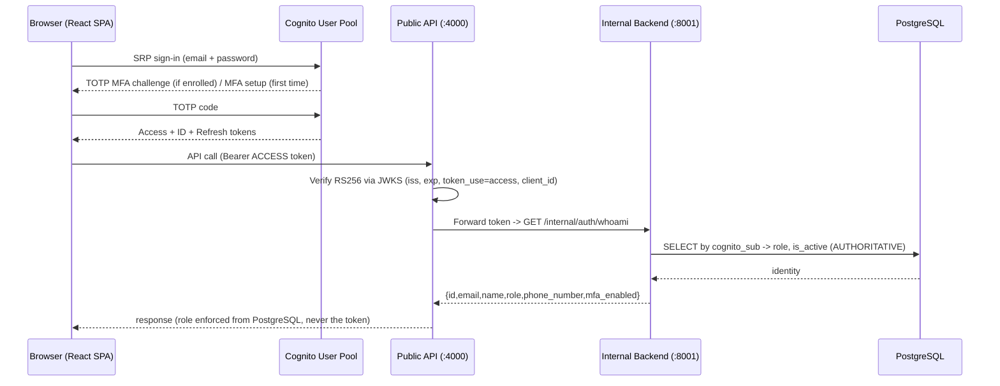

# Cognito Authentication Migration — Operator Guide

This document describes how to review, deploy, migrate, verify, and cut over the
Amazon Cognito authentication integration. **Nothing here has been deployed or
run against AWS or real users** — these are the manual steps you perform.

The migration is phased and reversible. `AUTH_MODE` (backend) and
`VITE_AUTH_MODE` (frontend) both default to `legacy`, so the existing HS256
login keeps working until you deliberately switch modes.

## Architecture summary



## Auth modes

| Mode | Backend/API behaviour | When to use |
|---|---|---|
| `legacy` (default) | HS256 app tokens only | Before cutover; rollback target |
| `dual` | Valid Cognito token OR legacy token; invalid Cognito tokens fail closed (never downgraded) | During migration window |
| `cognito` | Cognito access tokens only | After all users migrated + verified |

## Environment variables

Set these in `.env` (local) or Secrets Manager / container env (AWS). See
`.env.example` for the full list. Cognito IDs are **not secrets**.

- Backend/API: `AUTH_MODE`, `COGNITO_USER_POOL_ID`, `COGNITO_APP_CLIENT_ID`, `AWS_REGION`
- Frontend (build-time): `VITE_AUTH_MODE`, `VITE_COGNITO_USER_POOL_ID`, `VITE_COGNITO_APP_CLIENT_ID`, `VITE_AWS_REGION`

> Keep local Docker development on `legacy` with `DB_SSLMODE` unset/`disable`
> only for the LOCAL Postgres container — never carry a local `DB_SSLMODE=disable`
> into an AWS/RDS deployment.

## Admin-created Cognito accounts

The admin team-member endpoint and access-request approval both use the backend
Cognito provisioner. Admins select a role, but do not set or receive a password.
The provisioner reserves a PostgreSQL row with a random recovery key, creates
the Cognito user with an invitation, and only activates/maps the row after it
has verified the Cognito `sub`. A pending row remains inactive and unmapped if
the Cognito operation fails.

Before deploying this flow:

1. Apply the additive Alembic migration that adds
   `team_members.cognito_provisioning_id`.
2. Ensure the **running backend instance role** has
   `cognito-idp:AdminCreateUser`, `cognito-idp:AdminGetUser`, and
   `cognito-idp:ListUsers` scoped to the existing User Pool. The current CDK
   stack grants these actions to its separate migration role, not the
   application role; a backend-only rollout will therefore fail safely until
   runtime permissions are granted.
3. Confirm Cognito invitation email delivery is configured and usable.

If provisioning has a partial failure, an admin can retry the same request
with the same name, normalized email, and role. The persisted recovery key lets
the backend resume lookup of the exact Cognito username instead of creating a
second user. Existing Cognito users are linked only when a unique exact email
match is already verified; ambiguous or unverified matches are rejected.
Users should sign in with the username shown in the Cognito invitation, set
their permanent password, complete any returned MFA challenge, and then
continue through `/auth/whoami` for database-backed role resolution.

## Manual commands

> Replace placeholders (`<...>`). These are the exact commands to run yourself.
> The agent has NOT executed any of them.

### 1. CDK review (no deploy)

```bash
cd infra
npm ci
npm run build
npx cdk diff CloudnautSupportDeskStack --profile ram-cloudnaut
# optional: inspect the synthesized Cognito resources
npx cdk synth CloudnautSupportDeskStack --profile ram-cloudnaut | less
```

### 2. Deploy the stack (provisions Cognito; does not migrate users)

```bash
cd infra
npx cdk deploy CloudnautSupportDeskStack --profile ram-cloudnaut
# Note the outputs: CognitoUserPoolId, CognitoAppClientId, CognitoMigrationRoleArn
# (SMS MFA stays OFF unless you add:  -c enableSmsMfa=true )
```

### 3. Configure the apps with the Cognito outputs

```bash
# Backend/API env (Secrets Manager or container env):
#   AUTH_MODE=dual
#   COGNITO_USER_POOL_ID=<CognitoUserPoolId>
#   COGNITO_APP_CLIENT_ID=<CognitoAppClientId>
#   AWS_REGION=ap-south-1
#
# Frontend build:
#   VITE_AUTH_MODE=cognito  (only when you want the SPA to use Cognito)
#   VITE_COGNITO_USER_POOL_ID=<CognitoUserPoolId>
#   VITE_COGNITO_APP_CLIENT_ID=<CognitoAppClientId>
#   VITE_AWS_REGION=ap-south-1
```

### 4. Migration DRY-RUN (no changes, read-only)

```bash
# Assume the dedicated least-privilege migration role (CognitoMigrationRoleArn):
#   aws sts assume-role --role-arn <CognitoMigrationRoleArn> --role-session-name cognito-migrate --profile ram-cloudnaut
# then export the returned AWS_ACCESS_KEY_ID / SECRET / SESSION_TOKEN, and:
cd workspace/backend
PYTHONPATH=/path/to/workspace \
COGNITO_USER_POOL_ID=<id> AWS_REGION=ap-south-1 \
DATABASE_URL=<prod-readonly-or-prod-url> \
  ./.venv/bin/python -m app.cognito_migration --report-file dryrun-report.json
# Review dryrun-report.json: every row shows would_create / already_linked / skipped.
```

### 5. APPROVED migration (writes to Cognito + links cognito_sub)

```bash
cd workspace/backend
PYTHONPATH=/path/to/workspace \
COGNITO_USER_POOL_ID=<id> AWS_REGION=ap-south-1 \
DATABASE_URL=<prod-url> \
  ./.venv/bin/python -m app.cognito_migration --apply --report-file migration-report.json
# Idempotent: safe to re-run. Review migration-report.json for created/linked/failed.
```

### 6. End-to-end verification (dual mode)

- Sign in via the SPA with a migrated user; complete first-time TOTP enrollment.
- Confirm API calls succeed and the role shown matches PostgreSQL.
- Confirm an un-migrated user still logs in via legacy (dual mode).
- In Profile: add + verify a phone number; reset the authenticator.

```bash
# Backend/API test suites:
cd workspace/backend && PYTHONPATH=../:. ./.venv/bin/pytest -q
cd workspace/api && PYTHONPATH=. ./.venv/bin/pytest -q
# Frontend:
cd workspace/frontend && npm test && npm run build
```

### 7. Final cutover (Cognito only)

```bash
# After ALL users are migrated and verified:
#   Backend/API env: AUTH_MODE=cognito
#   Frontend build:  VITE_AUTH_MODE=cognito
# Redeploy/restart services. Legacy HS256 tokens are now rejected.
```

### Rollback

Set `AUTH_MODE=legacy` (and `VITE_AUTH_MODE=legacy`), redeploy/restart. The
Cognito User Pool uses `RemovalPolicy.RETAIN`, so identities and the
`cognito_sub` links survive; you can resume `dual` later without re-migrating.

## Safety notes

- Role and active status are ALWAYS read from PostgreSQL via the backend; token
  claims (role/groups) are never trusted for authorization.
- The migration tool never exports password hashes, never sets a Cognito
  password (invitation flow), and only ever fills a NULL `cognito_sub`.
- `email_verified=true` is set only for active users with an existing password
  hash (reliably verified); others must verify.
- SMS MFA is disabled by default (TOTP only). Enabling SMS incurs SNS cost and,
  for +91 numbers, DLT registration.
