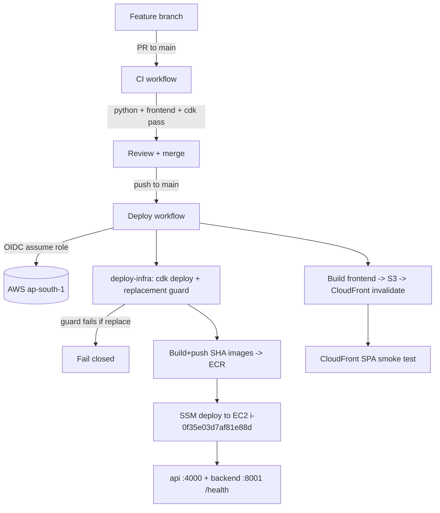

# CI/CD Architecture — Cloudnaut Support Desk

## Overview
GitHub Actions orchestrates CI and CD; AWS CDK is the infrastructure source of
truth. AWS access uses **GitHub OIDC** (no long-lived keys).

## Workflows (`.github/workflows/`)
| File | Triggers | Purpose | AWS creds |
|---|---|---|---|
| `ci.yml` | PR→main, push→main, dispatch | Python tests (Postgres service), frontend vitest+build, CDK test+synth | None |
| `deploy.yml` | push→main, dispatch | ECR build/push, SSM deploy, frontend S3+CloudFront, health checks | OIDC (`production` env) |

## CI jobs
- **backend-api-db**: Python 3.12; installs `workspace/backend` + `workspace/api` requirements; runs backend/api/database pytest against a disposable Postgres 16 service container (`DB_SSLMODE=disable`); validates the Alembic chain (`upgrade head` + single `heads`). No production DB, no real secrets.
- **frontend**: Node 20; `npm ci` + `npm test` (vitest) + `npm run build`.
- **cdk**: Node 20; `npm ci` + `tsc` + `jest` + `cdk synth CloudnautSupportDeskStack` (offline — real account id resolves the cached AZ lookup in `cdk.context.json`; Cognito IDs passed as public context).

## CD jobs (all in the `production` GitHub Environment)
0. **deploy-infra (guarded CDK)** — OIDC → `cdk synth` → CloudFormation **change-set safety guard**: the job FAILS CLOSED if any resource would be `Replacement: True` (EC2 instance, RDS, attachment/frontend buckets, Cognito pool). In-place updates and new resources are allowed. On pass → `cdk deploy CloudnautSupportDeskStack --require-approval never`. Runs **before** images/app so infra always matches the committed stack — this is what makes deployment fully automated while remaining non-destructive.
1. **build-and-push** — OIDC → ECR login → build backend (context = repo root, `-f workspace/backend/Dockerfile`) and api (context = `workspace/api`), tag with `${{ github.sha }}` **and** `latest`, push both.
2. **deploy-backend** — OIDC → `ssm send-command` to the instance: ECR login, pin `/opt/cloudnaut/docker-compose.prod.yml` to the SHA images, `docker compose pull`, `systemctl restart cloudnaut.service`, health-check `:4000` + `:8001`, auto-rollback to the backed-up compose on failure. Then verify the public API Gateway `/health`.
3. **deploy-frontend** — build with `.env.production` (public `VITE_*`), `s3 sync` hashed assets (immutable cache) + `index.html` (no-cache) to the CDK site bucket (resolved from stack output), CloudFront invalidation (waited), SPA smoke test.
4. **summary** — records infra status, SHA, image tag, instance, distribution.

Job order: `deploy-infra → build-and-push → deploy-backend → deploy-frontend → summary`.

Concurrency: `deploy-production` group, `cancel-in-progress: false` (no races, no mid-deploy cancel).

## AWS resources
Deployed production resources: EC2 `i-0276340dd92fb32c5` (`t8i.small`), RDS Postgres (private), S3 attachments, Secrets Manager, API Gateway `https://91kwn8bs53.execute-api.ap-south-1.amazonaws.com`, Cognito pool `ap-south-1_ywRrGmxpM`, frontend CloudFront `E1EKFXU60KQL5L`, ECR `cloudnaut-support-desk-{api,backend}`.

Added (CDK, additive — see `infra/lib/github-oidc.ts`): GitHub OIDC provider + `github-actions-cloudnaut-deploy` role (least privilege, trust scoped to `ramkrushnazende/ramkrushnazende-cloudnaut-support-desk` on `main`).

## Security
- OIDC only; no AWS keys in GitHub.
- Deploy role: scoped CDK bootstrap assume, ECR push to the 2 repos, SSM to the 1 instance, S3 to the site bucket pattern, CloudFront invalidation. No `*` admin.
- Secrets (DB URL, `AUTH_SECRET_KEY`, SMTP) stay in Secrets Manager → injected into `/opt/cloudnaut/app.env` on the instance; never in images, logs, frontend bundles, or git.
- `AUTH_MODE` on the instance is managed by `app.env` and **not** changed by the pipeline.
