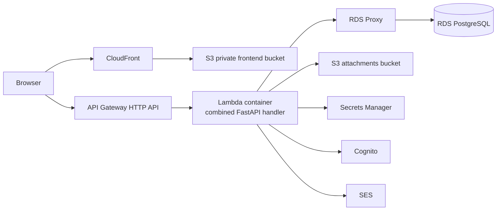

# Lambda Migration Architecture

## Recommendation

Replace the EC2 Docker host with a **single Lambda container function** that serves the application API, and keep the existing frontend and database services:



The frontend already uses the correct serverless pattern: CloudFront with Origin Access Control in front of a private S3 bucket. Cognito, S3, Secrets Manager, SES, and RDS can remain in place.

## Why one Lambda instead of two

The current deployment has two containers:

- `api`: public FastAPI proxy on port 4000
- `backend`: business API on port 8001, reached through the Docker network

Lambda does not provide a Docker Compose network or stable local service name. Deploying these as two Lambdas would require an extra HTTP hop, two separate cold starts, two sets of logs and permissions, and a new private service-to-service contract. Combining the two FastAPI applications behind one Lambda handler is the smallest reliable migration.

The combined handler should either:

1. mount the backend routes directly into the public application, or
2. keep the proxy routes but call backend functions in-process rather than through `http://backend:8001`.

Do not keep `BACKEND_URL=http://backend:8001` in the Lambda deployment.

## CDK resource changes

### Remove from `CloudnautSupportDeskStack`

- `ec2.Vpc` public application subnet. A Lambda outside the VPC is preferable for this workload.
- `ec2.SecurityGroup` for the EC2 host.
- EC2 instance role and its ECR pull, SSM, S3, Secrets Manager, Cognito, and SES policies.
- EC2 user data, Docker Compose, systemd service, AMI, EBS volume, and `ec2.Instance`.
- `HttpUrlIntegration` resources (`Ec2ProxyIntegration` and `Ec2RootIntegration`).
- EC2-specific GitHub OIDC permissions: SSM commands, instance ID, and Docker Compose rollout.
- `InstancePublicDns` output.
- The `instance.node.addDependency(db)` workaround. Lambda should not boot while waiting for a secret attachment.

### Keep

- RDS PostgreSQL, but place it in private subnets as it is today.
- S3 attachment bucket and its encryption/public-access settings.
- Secrets Manager secrets.
- Cognito User Pool and public SPA client.
- SES permissions, if email notifications remain enabled.
- Frontend stack: private S3 + CloudFront + OAC.

### Add

Use an HTTP API Lambda integration and a dedicated runtime role:

```ts
const lambdaRole = new iam.Role(this, 'ApiLambdaRole', {
  assumedBy: new iam.ServicePrincipal('lambda.amazonaws.com'),
  managedPolicies: [
    iam.ManagedPolicy.fromAwsManagedPolicyName(
      'service-role/AWSLambdaBasicExecutionRole',
    ),
  ],
});

attachmentsBucket.grantReadWrite(lambdaRole);
appSecret.grantRead(lambdaRole);
dbSecret.grantRead(lambdaRole);
lambdaRole.addToPolicy(new iam.PolicyStatement({
  actions: ['cognito-idp:GetUser'],
  resources: ['*'],
}));
lambdaRole.addToPolicy(new iam.PolicyStatement({
  actions: ['ses:SendEmail', 'ses:SendRawEmail'],
  resources: ['*'],
}));

const apiFunction = new lambda.DockerImageFunction(this, 'ApiFunction', {
  code: lambda.DockerImageCode.fromEcr(apiRepository, { tag: props.imageTag }),
  memorySize: 1024,
  timeout: Duration.seconds(29),
  environment: {
    AUTH_MODE: 'cognito',
    COGNITO_USER_POOL_ID: cognitoUserPoolId,
    COGNITO_APP_CLIENT_ID: cognitoAppClientId,
    S3_BUCKET: attachmentsBucket.bucketName,
    DATABASE_URL: 'use runtime secret loading or RDS Proxy endpoint',
  },
});

const httpApi = new apigwv2.HttpApi(this, 'HttpApi');
httpApi.addRoutes({
  path: '/{proxy+}',
  methods: [apigwv2.HttpMethod.ANY],
  integration: new integrations.HttpLambdaIntegration(
    'LambdaIntegration',
    apiFunction,
  ),
});
```

The exact Lambda construct depends on the final container layout. `DockerImageFunction` is useful if the existing ECR workflow is retained; `lambda.Function` with a zip or Python bundling is usually simpler and cheaper for a small FastAPI application.

## Database networking decision

A Lambda in the default AWS network cannot reach the current private RDS instance. There are two valid options:

### Preferred: Lambda outside the VPC + RDS Proxy with public connectivity

This is only valid if the security and account policy allow a controlled public RDS endpoint. It is usually not preferred for this stack because the database is intentionally private.

### Preferred for the current security posture: Lambda in the VPC + RDS Proxy

Add:

- Lambda subnets in the existing private/isolated VPC.
- Lambda security group.
- RDS Proxy in the VPC.
- Proxy security group ingress from Lambda SG on port 5432.
- RDS SG ingress from the Proxy SG, replacing direct EC2 SG ingress.
- VPC interface endpoints or NAT for Lambda dependencies that need network access.

At minimum, the VPC path needs endpoints for Secrets Manager, ECR API/ECR DKR if images are pulled through VPC during startup, and CloudWatch Logs. S3 can keep using the existing gateway endpoint. Cognito and SES need either NAT or suitable VPC endpoints; verify regional endpoint availability before choosing isolated subnets.

RDS Proxy is strongly recommended because Lambda concurrency can otherwise exhaust PostgreSQL connections. The application should also use a small SQLAlchemy pool, `pool_pre_ping=True`, and avoid running migrations on every invocation.

## Application changes required

1. Add a Lambda adapter such as `Mangum` for FastAPI.
2. Create one public ASGI application that exposes the routes currently split between `workspace/api` and `workspace/backend`.
3. Remove the runtime dependency on `BACKEND_URL` and Docker service discovery.
4. Move database initialization/migrations out of the container entrypoint. Run Alembic in CI/CD or as a one-time deployment job.
5. Load Secrets Manager values during cold start, cache them in module scope, and do not log them.
6. Replace local MinIO configuration in production with the existing S3 bucket. Keep MinIO only in local Docker Compose.
7. Prefer S3 presigned upload/download URLs for attachments so large files do not pass through API Gateway/Lambda.
8. Confirm every endpoint finishes within API Gateway's approximately 29-second integration limit. Long email or notification work should use SQS and a separate worker Lambda.
9. Set `FRONTEND_ORIGINS` from the CloudFront distribution output instead of maintaining a growing hard-coded list.
10. Ensure the Lambda image uses the Lambda Python base image and a Lambda handler command, not `uvicorn` as the process supervisor.

Example handler dependency:

```text
mangum
```

Example handler shape:

```python
from mangum import Mangum
from app.main import app

handler = Mangum(app, lifespan="off")
```

## CI/CD changes

The current workflow builds two ECR images and deploys them through SSM to EC2. Change it to:

1. Build the combined Lambda image.
2. Push the image to one ECR repository.
3. Run tests and database migrations as a separate controlled step.
4. Deploy the Lambda function or update its image tag with CDK/CloudFormation.
5. Wait for the Lambda version/update to become active.
6. Run a health smoke test through the API Gateway URL.
7. Remove SSM, instance ID, Docker login on the host, and Compose rollback commands.

Keep the frontend workflow unchanged except for its API URL output.

## Service mapping

| Current service | Lambda target | Change |
|---|---|---|
| EC2 + Docker Compose | AWS Lambda | Remove host; one combined function |
| API Gateway HTTP proxy | API Gateway HTTP API | Keep API; replace HTTP URL integration with Lambda integration |
| API ECR + Backend ECR | One Lambda ECR image | Combine application packaging, or use zip deployment |
| EC2 IAM role | Lambda execution role | Keep only S3, Secrets Manager, Cognito, SES, Logs permissions |
| EC2 SG to RDS SG | Lambda SG -> RDS Proxy SG -> RDS SG | Change networking and add RDS Proxy |
| RDS PostgreSQL | RDS PostgreSQL + RDS Proxy | Keep DB; add connection pooling layer |
| MinIO | S3 | Production already has S3; remove MinIO from production |
| EC2 user-data migrations | CI/CD migration job | Never migrate on each cold start |
| SSM deployment | CDK/Lambda image update | Remove instance rollout |
| CloudFront + S3 frontend | CloudFront + S3 frontend | No change |
| Cognito | Cognito | No change |

## Migration order

1. Build and test a combined FastAPI application locally without Docker-network calls.
2. Add the Lambda adapter and invoke it with a local Lambda event test.
3. Add RDS Proxy and change security groups while EC2 remains active.
4. Deploy Lambda and a separate API Gateway stage or route for smoke testing.
5. Test authentication, MFA checks, ticket CRUD, attachments, notifications, and password reset.
6. Switch the frontend `VITE_API_URL` to the Lambda-backed API endpoint.
7. Remove EC2, old proxy integration, ECR repository, and SSM permissions only after rollback validation.

## Important trade-offs

- Lambda removes EC2 management and idle host cost, but VPC cold starts and RDS Proxy add operational complexity.
- Lambda is a poor fit for long-running jobs, WebSockets, or requests that exceed API Gateway timeout limits.
- RDS remains the largest architectural constraint. Replacing RDS with Aurora Serverless v2 is not required and may conflict with the existing account SCP that blocks `rds:CreateDBCluster`.
- For the current two-service codebase, ECS Fargate behind an internal ALB is the lower-change alternative. It removes EC2 management while preserving Docker Compose-like service separation, but it is not as cost-efficient as a well-adapted Lambda deployment for a low-volume API.
